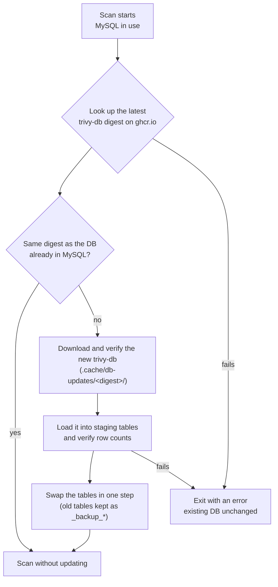

# BOLT

**B**inary-**O**riented container image **L**ayer analysis & **T**hreat-reporting SBOM generator

BOLT generates a CycloneDX SBOM and a vulnerability report for a container image, with a
focus on the binaries inside it. Beyond the OS and language packages that a package-based
scanner sees, BOLT looks into the executables and shared libraries that the image's own
layers bring in, identifies the open-source components they contain, maps their runtime
library dependencies, and checks those components for known vulnerabilities.

BOLT is a modified version of [Trivy](https://github.com/aquasecurity/trivy) by Aqua
Security. See [License](#license).

## Contents

- [Features](#features)
- [How it runs](#how-it-runs)
- [Quick start](#quick-start)
- [Build the component database](#build-the-component-database)
- [Scanning](#scanning)
- [Reading the output](#reading-the-output)
- [Vulnerability database](#vulnerability-database)
- [Cleanup](#cleanup)
- [Contributing](#contributing)
- [License](#license)
- [Security](#security)

## Features

- **Layer-aware binary analysis:** binaries are analyzed in the layers an image adds on
  top of its base image to bring in content, such as `COPY`/`ADD` or `RUN` steps that
  download or unpack files. Package installs are left to the regular package scanners.
- **Binary SBOM generators:** `bom-blint` (the default) statically analyzes each binary.
  `bin-sbom`, the Binary_SBOM_Generator from the Software Security and Privacy
  Laboratory, Korea University, decompiles binaries to identify the open-source
  components compiled into them.
- **Vulnerabilities in binary components:** components found in binaries are checked
  against the vulnerability database like any other package.
- **Runtime dependency graph:** shared-library dependencies of ELF binaries, resolved
  recursively within the image.
- **Component classification:** each component is tagged as an application, system or
  unknown component.
- **MySQL vulnerability database,** refreshed automatically from the official Trivy DB.

## How it runs

BOLT runs under Docker Compose as two services: `bolt`, the scanner image with both binary
SBOM generators, and `mysql`, which holds the vulnerability database. The repository is
mounted into the scanner at `/work`; bin-sbom reads its component database and Ghidra
from there.

> [!IMPORTANT]
> **bin-sbom requires a component database that you build first.** BOLT does not
> distribute one, and `repolist.txt`, the list of projects to collect, ships empty. Before
> using `--binary-sbom bin-sbom`, follow
> [Build the component database](#build-the-component-database). Without a database,
> scans with bin-sbom stop before scanning. The default generator, bom-blint, does not
> need one.

## Quick start

### Requirements

- Docker, and Docker Compose v2 with support for `docker compose up --wait`
- Network access to `ghcr.io` (vulnerability DB) and, for bin-sbom, `github.com` (Ghidra)
- Disk space for:
  - the vulnerability DB: download cache, MySQL data, and backup tables left by updates
    (see [Disk usage](#disk-usage))
  - Ghidra (about 640MB) and, once built, the component database (size depends on the
    projects you collect)

### Install

```bash
git clone https://github.com/KAIST-CysecLab/BOLT.git
cd BOLT

./init.sh                           # default install, including bin-sbom and Ghidra
INSTALL_BIN_SBOM=false ./init.sh    # without bin-sbom
```

`init.sh` does the following:

1. **Writes `.env`.**
   - Checks that the Docker socket exists at `/var/run/docker.sock`, which
     `docker-compose.yml` mounts into the bolt container, and stops if it does not.
   - Records your UID/GID and the Docker socket group, so the container writes files as
     your user.
   - Generates random MySQL passwords on the first run and keeps them on later runs, because
     MySQL applies a password only when it first creates its volume. `.env` is readable by
     its owner only (mode 600).
   - If `.env` holds no passwords but a MySQL volume from an earlier install exists, it
     prints the commands to remove that volume and stops.
2. **Installs Ghidra** for bin-sbom (skipped with `INSTALL_BIN_SBOM=false`) by running
   `fetch-bin-sbom-data.sh`.
   - Ghidra 11.2.1 is downloaded from its official GitHub release and checked against the
     SHA-256 published in the release notes.
   - If no component database is installed, it prints a warning and continues.
3. **Builds the `bolt:dev` image** (`docker build -f Dockerfile.bolt -t bolt:dev .`). With
   bin-sbom, the image also gets the bin-sbom package and JDK 21 for Ghidra. Ghidra and the
   component database are mounted at scan time, not baked into the image.
4. **Loads the vulnerability database** by running `update-db.sh`: starts MySQL, waits for
   it (up to 120 seconds), then downloads the official Trivy DB and loads it into MySQL
   (time limit 30 minutes).

Run `./init.sh` again after changing BOLT's code to rebuild the image.

### First scan

```bash
docker pull ubuntu:22.04
docker compose run --rm bolt \
  image ubuntu:22.04 \
  --format cyclonedx --scanners vuln \
  -o out.json
```

This uses bom-blint for binaries. `init.sh` installs bin-sbom and Ghidra but **not a
component database**, so bin-sbom is not usable yet: to scan with it,
[build the component database](#build-the-component-database) first, then add
`--binary-sbom bin-sbom`.

## Build the component database

> [!IMPORTANT]
> This step is required before bin-sbom can be used. BOLT does not distribute a component
> database, so every installation builds its own (or installs one its team built; see
> [Sharing a built database](#sharing-a-built-database)).

bin-sbom identifies OSS components by comparing the functions in a binary against a
component database (CDB) built from the source code of the projects you want to detect.
The CDB is built on the host with two scripts from `Binary_SBOM_Generator/`: the collector
(`OSScollector.py`) clones the listed projects, and the preprocessor (`preprocessor.py`)
turns them into the database.

Building takes a while and needs disk space in proportion to the projects you list. As a
reference point, 66 projects took several hours, about 4GB of cloned sources and about
1.1GB for the resulting database.

### Prerequisites

- `git`
- Python 3.10 or later and [uv](https://github.com/astral-sh/uv)
- [universal-ctags](https://github.com/universal-ctags/ctags)
  (on Debian/Ubuntu: `sudo apt-get install -y universal-ctags`)

### 1. List the projects to collect

`Binary_SBOM_Generator/osscollector/repolist.txt` is empty in this repository. Add one
project per line:

```
<git URL>, <library|application>, ["<tag>", ...]
```

For example:

```
https://github.com/madler/zlib.git, library, ["v1.3.1"]
https://gitlab.com/bzip2/bzip2.git, library, ["bzip2-1.0.8"]
https://github.com/inikep/lzbench.git, application
```

- The second field defaults to `library`.
- The tag list is optional. Without it, the collector uses its built-in tag list for a few
  well-known projects, otherwise the latest version tag, otherwise the latest commit
  (`HEAD`). List tags or commits explicitly if you need the same database every time you
  build it.
- The file does not support comment lines.

### 2. Collect the sources

```bash
cd Binary_SBOM_Generator
uv sync
uv run python src/OSScollector.py osscollector
```

This clones the projects under `osscollector/` and extracts their functions and metadata.
Projects that already completed are skipped when you run it again.

### 3. Build the database

```bash
uv run python src/preprocessor.py
```

The result is laid out as follows; these directories are kept out of git and the Docker
image (`.gitignore`, `.dockerignore`):

```
Binary_SBOM_Generator/
├── database/                    component database
│   ├── componentDB/             components, functions, strings, symbols, control blocks, call graph
│   ├── functionFeatures/        function feature vectors
│   ├── cb_blocks.index          control-block similarity index
│   ├── cb_blocks_meta.json
│   └── provenance/
├── osscollector/repo_meta/      per-component metadata (name, reference version, PURL)
└── tools/ghidra/ghidra_11.2.1_PUBLIC/   Ghidra, installed by init.sh
```

### 4. Use it

Select bin-sbom when scanning:

```bash
docker compose run --rm bolt image ubuntu:22.04 \
  --format cyclonedx --scanners vuln \
  --binary-sbom bin-sbom \
  -o out.json
```

Nothing else needs to be configured. `docker compose run` mounts the repository at `/work`,
and the image points bin-sbom at it:

- `BIN_SBOM_DB=/work/Binary_SBOM_Generator` (the parent of `database/` and
  `osscollector/repo_meta/`)
- `BIN_SBOM_GHIDRA=/work/Binary_SBOM_Generator/tools/ghidra/ghidra_11.2.1_PUBLIC`

To keep the CDB or Ghidra outside the repository, change these variables and mount the
location into the container as well.

Before scanning, BOLT checks that the component database is complete. If bin-sbom is
selected and the database is missing or incomplete, BOLT prints a warning and exits
without scanning.

The CDB contains data derived from the source code of the projects you collected, such as
function hashes, function names, file paths, strings and license metadata. Check the
licenses of those projects before you share a CDB outside your team.

### Sharing a built database

To reuse a CDB on other machines without rebuilding it, package it and host the archive
yourself:

```bash
./pack-bin-sbom-data.sh                                       # on the machine that built it
BIN_SBOM_DATA_URL=<url> ./fetch-bin-sbom-data.sh              # on another machine
```

The archive is not checksum-verified, so host it somewhere you trust.

## Scanning

```bash
docker compose run --rm bolt \
  image <image> \
  --format cyclonedx --scanners vuln \
  -o <output>.json
```

- `<image>`: a container image, either available in the local Docker daemon
  (`docker pull`, `docker build`) or pulled from its registry.
- `--format cyclonedx --scanners vuln`: CycloneDX output with vulnerability scanning.
- `-o <output>.json`: written to the repository root (`/work` in the container).
- The MySQL connection is passed in by `docker-compose.yml` as `TRIVY_MYSQL_DSN`, built from
  the password in `.env`. An explicit `--mysql-dsn` takes precedence.
- `docker compose run` starts MySQL if needed and waits until it is ready.

<!-- Keep this warning when the README is rewritten: docker-compose.yml mounts the host Docker socket by default. -->
> [!WARNING]
> **The host Docker socket is mounted.** To read local images, `docker-compose.yml` mounts
> the host's `/var/run/docker.sock` into the bolt container. A container with access to the
> Docker socket has the same privileges as root on the host (it can start a container that
> mounts the host filesystem).
> BOLT analyzes the binaries inside the scanned image with several parsers, including Ghidra
> and bom-blint, so a malicious image that exploits one of them could affect the host, not
> only the container.
> Scan images from untrusted sources in an isolated environment, such as a dedicated VM.

### Options

BOLT accepts Trivy's options; see the
[`trivy image` reference](https://trivy.dev/docs/v0.59/references/configuration/cli/trivy_image/)
in the [Trivy v0.59 documentation](https://trivy.dev/docs/v0.59/), the release BOLT is based
on. The options BOLT adds or changes:

| Option | Default | Description |
|---|---|---|
| `--binary-sbom <generators>` | `bom-blint` | Binary SBOM generators: `bom-blint`, `bin-sbom` (requires a [component database](#build-the-component-database)), `none`. Comma-separated for more than one. |
| `--binary-sbom-timeout <duration>` | none | Time limit per binary for a generator, for example `10m`. A file that exceeds it is skipped with a warning. |
| `--libtree=on\|off` | `on` | Add the runtime dependency graph of ELF binaries to the SBOM. |
| `--timeout <duration>` | `2h` | Time limit for the whole scan, **including the vulnerability DB update**. |
| `--mysql-dsn <DSN>` | compose `mysql` | MySQL server holding the vulnerability DB. Under `docker compose`, the compose `mysql` service is used unless this is set. |
| `--skip-db-update` | off | Use the current MySQL contents without checking for a newer DB. |

### Binary SBOM generators

| Value | Description | Time |
|---|---|---|
| `bom-blint` (default) | Static analysis of the binary itself | Tens of milliseconds per binary |
| `bin-sbom` | Decompilation-based OSS component detection. **Requires a [component database](#build-the-component-database) that you build first**, and Ghidra (installed by `init.sh`). | Minutes per binary |
| `none` | No binary SBOM | - |

```bash
# bin-sbom with a longer scan limit and a per-binary limit
docker compose run --rm bolt image ubuntu:22.04 \
  --format cyclonedx --scanners vuln \
  --binary-sbom bin-sbom --timeout 4h --binary-sbom-timeout 10m \
  -o out.json

# both generators
... --binary-sbom bom-blint,bin-sbom ...
```

- bin-sbom takes minutes per binary, so images with many binaries need a longer `--timeout`
  or a `--binary-sbom-timeout`.
- A generator that fails on one file does not fail the scan; that file's data is left out
  with a warning.
- When a generator cannot be used:

  | Situation | Behavior |
  |---|---|
  | A generator named with `--binary-sbom` is not installed | Error, scan stops |
  | The default generator (`bom-blint`) is not installed | Warning, scan continues without binary SBOM data |
  | bin-sbom is selected but the component database is missing or incomplete | Warning, scan stops |
  | `--binary-sbom none` | No generator is looked up |

### Runtime dependency graph

On by default. Turn it off with `--libtree=off`.

- Write the value with `=`. In `--libtree off`, `off` is read as the image name.
- `--libtree=true` and `--libtree=false` are accepted as `on` and `off`.

## Reading the output

The output is CycloneDX 1.6 JSON. BOLT records its additional information in each
component's `properties`.

- **Binary components:** components found by a binary SBOM generator carry a `metadata`
  property naming the generator (`bin_sbom` or `bom_blint`). When both generators analyze
  the same binary, it gets a single root component tagged by both. These components are
  checked for vulnerabilities, and the results are listed in `vulnerabilities`.
- **Runtime dependency graph:** shared-library dependencies of ELF binaries are resolved
  recursively within the scanned image's filesystem, not the host's, and recorded as
  components and `dependencies`. Nodes of this graph carry `metadata=libtree`.
- **Component classification:** every component has a `bolt:component:group` property:

  | Value | Meaning |
  |---|---|
  | `app-cmp` | Application component: language packages, third-party OSS inside binaries |
  | `sys-cmp` | System component: OS packages, shared libraries a binary links against |
  | `unknown-cmp` | Matches none of the rules |

## Vulnerability database

### Automatic updates

BOLT reads vulnerability data from MySQL. The data is not maintained by hand: BOLT
downloads the official vulnerability database that Aqua Security publishes for Trivy
(**trivy-db**, `ghcr.io/aquasecurity/trivy-db:2`, rebuilt about every 6 hours) and converts
it into MySQL tables.

Every scan that uses MySQL (the default under `docker compose`) first does the following:



- **No new DB:** one digest lookup, then the scan. Nothing is downloaded or loaded.
- **New DB:** that scan replaces the whole database before scanning. Updates replace all
  tables; they are not incremental.
- **Update fails:** the existing data stays, and the scan fails rather than silently
  scanning with an outdated database.
- Without any MySQL connection (outside compose, with neither `--mysql-dsn` nor
  `TRIVY_MYSQL_DSN`), BOLT falls back to Trivy's behavior and keeps the DB file in `.cache`.

### Updating ahead of time or skipping updates

`init.sh` loads the database once. Because `--timeout` includes the update, scanning
against an empty MySQL spends part of the scan time on the first load.

```bash
./update-db.sh                       # update only, no scan
./update-db.sh --timeout 45m         # with a longer limit
BOLT_MYSQL_DSN='bolt:...@tcp(db.example:3306)/bolt_db' ./update-db.sh   # another MySQL server
```

`update-db.sh` starts MySQL, waits until it is ready, and runs only the update
(`--download-db-only`). It keeps the `mysql_data` volume, so the same command serves a new
and an existing database.

To scan with the current MySQL contents, add `--skip-db-update`. This is useful without
access to `ghcr.io` (a failed digest lookup otherwise stops the scan), with a read-only
MySQL account, or to scan several images against the same DB.

```bash
docker compose run --rm bolt image locally-available-image:tag \
  --mysql-dsn 'reader:...@tcp(mysql:3306)/bolt_db' \
  --skip-db-update --skip-java-db-update --offline-scan \
  --scanners vuln --format cyclonedx -o out.json
```

- `--skip-db-update` cannot be combined with `--download-db-only`.
- To avoid the Java DB download and external dependency lookups as well, add
  `--skip-java-db-update --offline-scan`.

### Using a separate MySQL server

By default the `mysql` container started by `docker compose` is used. To use an existing
MySQL server instead, point `--mysql-dsn` at it.

1. **Do not store other data in this database.** Each update replaces all four tables with
   the official DB, so data added by hand is lost.
2. **To update the DB only**, add `--no-deps` so that the compose `mysql` container is not
   started:

   ```bash
   docker compose run --rm --no-deps bolt image \
     --download-db-only --timeout 30m \
     --mysql-dsn 'bolt:...@tcp(db.example:3306)/bolt_db' \
     --db-repository ghcr.io/aquasecurity/trivy-db:2
   ```

One way to run this: update periodically with a writable account, and scan with a
read-only account and `--skip-db-update`. Scans then do not wait for updates, and you
decide when updates happen.

### Disk usage

Since trivy-db is republished about every 6 hours, the first scan or `update-db.sh` after
that reloads the whole database. Each reload leaves the following behind, and **nothing
removes them automatically**:

| Location | Contents | How to clean up |
|---|---|---|
| MySQL `*_backup_*` tables | The previous DB, for recovery | `DROP TABLE` once the new DB is confirmed, following your retention needs |
| `.cache/db-updates/<digest>/` | Downloaded trivy-db files | Delete directories that `current.json` does not point to |

During an update the existing data, the new staging tables and the backups exist at the
same time, so leave room for all three.

The compose MySQL does not publish a port on the host. To connect to it, for example to
drop backup tables, connect from inside its container:

```bash
docker compose exec mysql sh -c 'mysql -uuser -p"$MYSQL_PASSWORD" bolt_db'
```

## Cleanup

```bash
docker compose down -v      # -v also removes the MySQL volume (vulnerability DB)
docker rmi bolt:dev mysql:8.4
rm -rf .cache               # vulnerability DB download cache
```

To remove the bin-sbom data as well, delete `Binary_SBOM_Generator/database`,
`Binary_SBOM_Generator/osscollector/repo_meta` and `Binary_SBOM_Generator/tools/ghidra`.

## Contributing

Issues and pull requests are welcome. Please report security vulnerabilities as described
in [SECURITY.md](SECURITY.md) instead of opening a public issue.

## License

BOLT is distributed under the [Apache License 2.0](LICENSE). It is a modified version of
Trivy by Aqua Security; files modified for BOLT carry a "Modified by" notice at the top.
See [NOTICE](NOTICE) for attributions, including the bundled third-party components.

bin-sbom ([`Binary_SBOM_Generator/`](Binary_SBOM_Generator/)) is the Binary_SBOM_Generator
developed by the Software Security and Privacy Laboratory, Korea University, with
modifications for BOLT, and is distributed under the [MIT License](Binary_SBOM_Generator/LICENSE):

    Copyright (c) 2026 Software Security and Privacy Laboratory, Korea University

## Security

See [SECURITY.md](SECURITY.md) for how to report a vulnerability.
